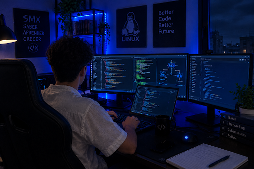
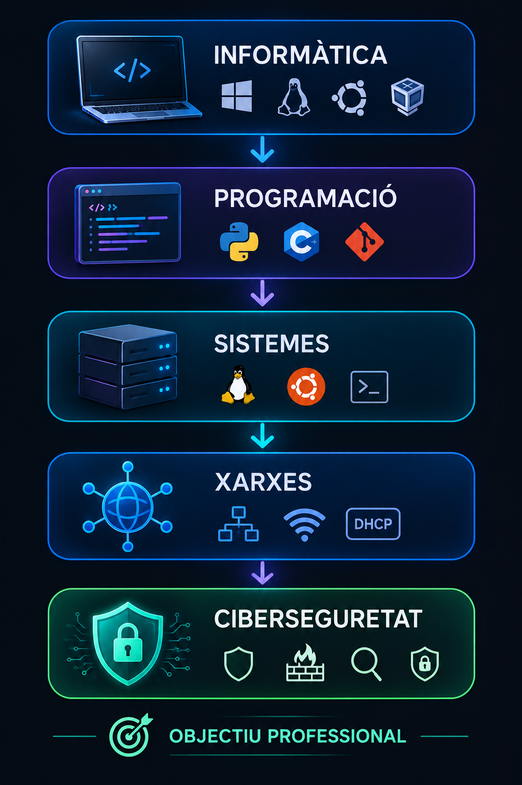

╔════════════════════════════╗

|--------------🖥️Biel Estruch Jimez--------------|

|----------SMX 2º · SISTEMES · XARXES----------|

|----------🔧 Construint coneixements----------|  
|---------------🌐 Explorant xarxes--------------|  
|------------🔐 Futur: Ciberseguretat------------|

╚════════════════════════════╝

# Hola, soc en Biel Estruch Jimenez

Soc estudiant de **2n de SMX (Sistemes Microinformàtics i Xarxes)** a **Escola Pia Mataró - Santa Anna**.

M'interessa el món de la informàtica i actualment estic aprenent diferents tecnologies relacionades amb els sistemes, les xarxes i la programació.

## Qui soc?

Soc estudiant de segon de SMX i m'agrada aprendre mitjançant pràctiques i projectes.

L'assignatura que més m'agrada és **Programació**, perquè és la que se'm dona millor. La que més em costa actualment és **Serveis de Xarxa**, però vull continuar millorant i aprenent sobre aquest tema.

## Què estic estudiant?

Actualment estic cursant **2n de SMX**.

Durant aquest curs estic treballant en:

- Projecte Intermodular
- Competències Professionals per a l'Ocupabilitat
- Programació
- Sistemes Operatius en Xarxa
- Seguretat Informàtica
- Serveis de Xarxa
- Sostenibilitat Aplicada al Sistema Productiu

## Tecnologies i competències

Durant el cicle he treballat amb diferents eines i tecnologies:

### Sistemes i xarxes

- Windows
- Ubuntu / Linux
- VirtualBox
- Xarxes TCP/IP
- Netplan
- SSH
- Bash i terminal Linux
- DHCP / Kea
- Màquines virtuals

### Programació

També estic aprenent programació i desenvolupant diferents exercicis i pràctiques durant el cicle.

## Projectes i pràctiques

Alguns dels treballs i pràctiques que he realitzat durant SMX són:

- Configuració de màquines virtuals amb VirtualBox.
- Configuració de xarxes en Ubuntu Server.
- Configuració d'adreces IP mitjançant Netplan.
- Connexions remotes mitjançant SSH.
- Configuració de serveis de xarxa.
- Instal·lació i configuració de Kea/DHCP.
- Pràctiques amb Linux i Bash.
- Exercicis de programació.
- Pràctiques amb GitHub.

## Objectius professionals

El meu objectiu és continuar aprenent sobre informàtica i millorar els meus coneixements en sistemes, xarxes i programació.

En el futur m'agradaria especialitzar-me en **ciberseguretat** i continuar formant-me per poder treballar en aquest sector.
### 🌐 El meu camí en informàtica

## Interessos personals
En el meu temps lliure m'agrada **anar al gimnàs**.

També m'interessa la tecnologia i continuar aprenent coses noves relacionades amb la informàtica.

## Què vull continuar aprenent?
- Administració de sistemes
- Xarxes
- Serveis de xarxa
- Programació
- Seguretat informàtica
- Git i GitHub
- Ciberseguretat

## Contacte
**GitHub:** [Biel Estruch](https://github.com/BielEstruch)